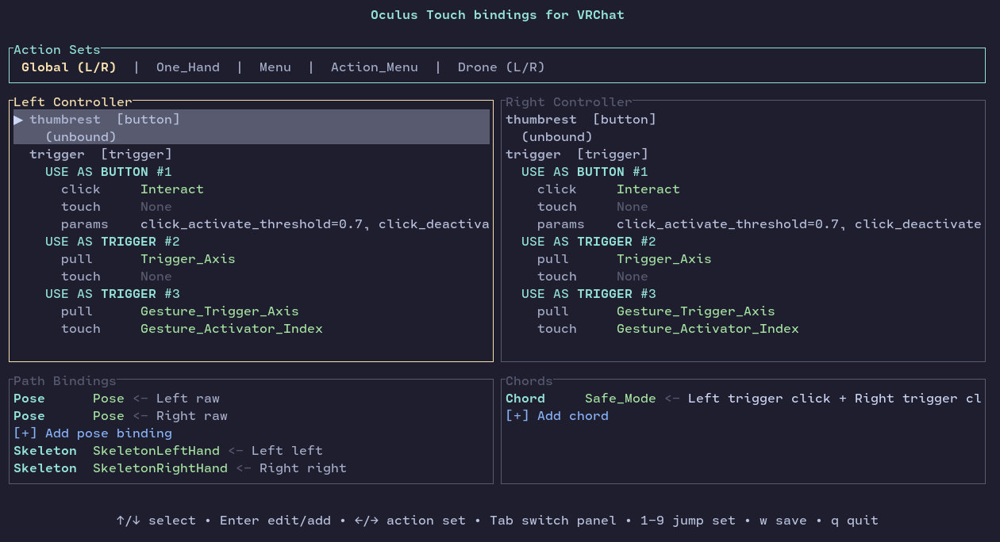

# OpenVR bindings are hard.



We all know that, but maybe they don't have to be hard anymore.

With cutting-edge features such as arrow key support, this lightweight TUI will save you from having to descend into JSON hell!

## Installation

AUR package: `obah-git`

Via cargo:
```sh
cargo install obah
```

Or grab the portable binary from Releases.

## Usage

### Steam titles

- Simply start the program, it will scan for your Steam games.

```sh
obah
```

### Non-steam titles

```sh
obah /path/to/MyGame
```

~~ or ~~
  
```sh
cd /path/to/MyGame
obah .
```

Where MyGame is the main folder of the game, normally containing the main executable / launcher.

## Join the Linux VR Community

We are available on either:

- Discord: <https://discord.gg/gHwJ2vwSWV>
- Matrix Space: `#linux-vr-adventures:matrix.org`
